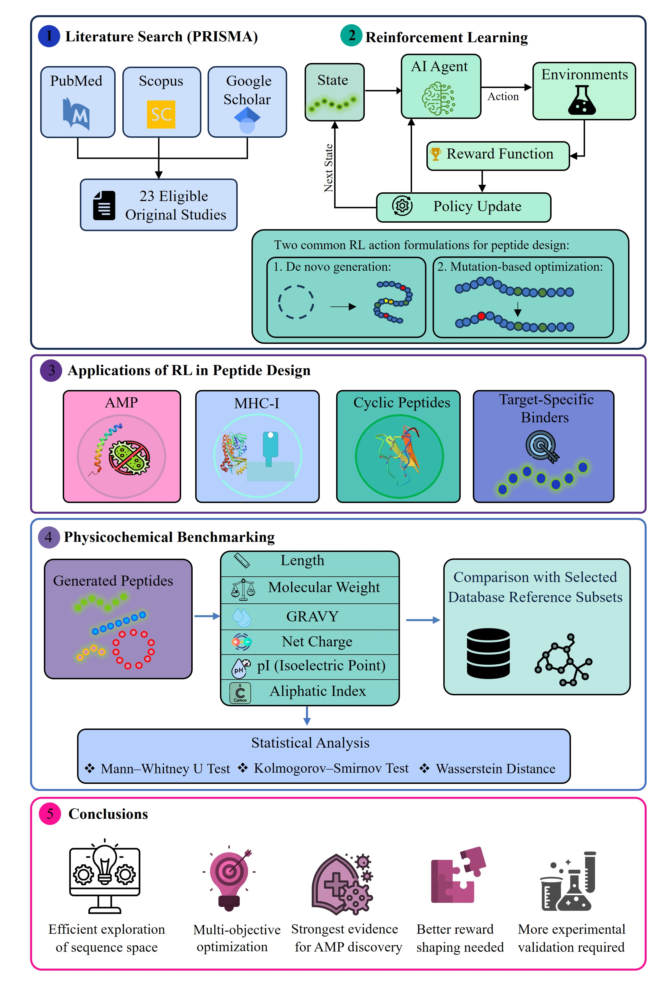

# RL-Peptide-Property-Benchmarking

<p align="center">
  
</p>

<p align="center">
  <strong>Reinforcement Learning in Peptide Design</strong><br>
  <em>A Systematic Review and Original Property-Based Benchmarking Analysis of Generated Sequences</em>
</p>

[](LICENSE)
[](RL-Peptide-Property-Benchmarking.ipynb)
[](CITATION.cff)

## Overview

This repository accompanies a systematic review of **23 studies** applying reinforcement learning (RL) and RL-inspired, reward-guided approaches to peptide generation, sequence optimization, structure-aware search, and candidate prioritization. It contains a sequence-level **physicochemical benchmarking workflow** for **148 selected, publicly reported peptide candidates**, together with a saved HTML analysis report and documentation of the reference-set preparation procedures.

The benchmarking compares the **available, selected candidate sequences** against **selected, task-related database reference subsets**. It does **not** compare algorithms under a shared training or generation budget, estimate biological activity, establish sequence novelty, or rank overall model quality. A smaller physicochemical distributional distance means closer agreement **only for the descriptors and reference subset used**; a departure from a reference distribution may reflect a deliberate design objective.

> **Reproducibility and data-access notice:** The public repository currently contains the generated-candidate FASTA and the **IEDB** reference FASTA, but **does not distribute the selected APD6 or CycPeptMPDB reference FASTA files** while their redistribution/provenance conditions are being clarified. The notebook requires all four FASTA inputs to regenerate the full report. The existing [HTML report](peptide_benchmarking_report.html) can be inspected without those inputs. **A complete independent rerun using only publicly hosted files in this repository is not presently possible.** See [Reference datasets and data access](#reference-datasets-and-data-access) and the [reference preparation notes](reference_dataset_preparation/README.md).

## At a glance

| Item | Scope |
| --- | --- |
| Studies included in the systematic review | **23** |
| Generated / selected sequences benchmarked | **148**: AMP **77**, Cyclic **39**, MHC **4**, Mixed **28** |
| Selected reference subsets | **229 sequences each** for AMP (APD6), MHC (IEDB), and Cyclic (CycPeptMPDB); **none** for Mixed |
| Sequence-derived descriptors | Length, nominal molecular weight (MW), GRAVY, isoelectric point (pI), net charge at pH 7.0, aliphatic index |
| Primary AMP reference comparisons | **Six descriptors** |
| Primary Cyclic reference comparisons | **Three descriptors**: Length, GRAVY, AliphaticIndex |
| MHC and Mixed | Descriptive only in the reported model-level benchmarking: MHC groups have **n = 2** each; Mixed lacks a common reference subset |
| Uncertainty | **2,000** peptide-level bootstrap resamples, random seed **42**; conditional on the selected candidates and reference sets |

## Repository files

| Path | Description |
| --- | --- |
| [`RL-Peptide-Property-Benchmarking.ipynb`](RL-Peptide-Property-Benchmarking.ipynb) | Main Python / Google Colab notebook for property calculations, statistical comparisons, similarity and sensitivity analyses, visualization, and HTML generation |
| [`Property-based benchmarking.fasta`](Property-based%20benchmarking.fasta) | The **148** publicly reported candidates selected for this analysis; source-identifying FASTA headers |
| [`peptide_benchmarking_report.html`](peptide_benchmarking_report.html) | Saved report with tables, diagnostics, figures, distributional comparisons, and sensitivity results |
| [`graphical_abstract.jpg`](graphical_abstract.jpg) | Graphical overview |
| [`reference_dataset_preparation/`](reference_dataset_preparation/) | Reference preparation notebooks, the distributed IEDB reference FASTA, provenance and licensing notes |
| [`requirements.txt`](requirements.txt) | Project dependency names (currently **not** an exact lockfile) |
| [`CITATION.cff`](CITATION.cff) | Repository citation metadata |
| [`LICENSE`](LICENSE) | Apache-2.0 license for original project code; **not** a blanket license for third-party data |

File names in this table correspond to the current repository. The previously mentioned `peptide_benchmarking_report_PUBLICATION_READY.html`, `pI_audit_before_after.csv`, and a root-level `DATA_LICENSES.md` are **not** included in the present repository snapshot.

## Benchmarking methods

### 1. Sequence handling and physicochemical descriptors

The notebook parses canonical amino-acid sequences and reports sequence-integrity diagnostics. Physicochemical features are computed using **Biopython 1.86** in the study workflow:

| Descriptor | Interpretation |
| --- | --- |
| Length | Number of amino-acid residues |
| MW | Nominal sequence-derived molecular weight |
| GRAVY | Mean Kyte–Doolittle hydropathicity |
| pI | Charge-zero pH estimated by **bisection over pH 0–14**, using Biopython's `ProteinAnalysis.charge_at_pH()` model |
| Net charge | Biopython's estimated **fractional** net charge at pH 7.0, including ionizable terminal contributions in the linear-sequence representation |
| AliphaticIndex | Sequence-derived aliphatic index |

The notebook also evaluates selected literature-based criteria: AMP length **10–50** and charge **+2 to +9**; MHC length **8–10** with an additional nine-mer summary; and Cyclic length **7–40**. These are **descriptive operational criteria**, not activity labels or validated universal quality thresholds. In particular, the Biopython fractional charge estimate need not be chemically identical to nominal integer charge definitions used in source studies.

For cyclic/macrocyclic peptides, simplified amino-acid strings do **not** encode cyclization topology, stereochemistry, N-methylation, terminal chemistry, or disulfide connectivity. Thus MW, pI, and charge are available only as **exploratory linear-sequence approximations** and are excluded from the **primary Cyclic** composite comparisons.

### 2. Reference-dependent distributional comparisons

For each eligible model and, separately, generation strategy, the workflow calculates descriptive statistics, **Mann–Whitney U** and **Kolmogorov–Smirnov** tests, reference **P5–P95 coverage**, and **normalized Wasserstein distances**. Tests require **at least three** available candidate sequences per group. Benjamini–Hochberg false-discovery-rate adjustment is applied **separately for each test family within each peptide category**; adjusted q-values are used for exploratory interpretation. A non-significant test is **not** evidence of equivalent distributions.

The normalized distance for a descriptor is its Wasserstein distance divided by the standard deviation of the corresponding reference distribution, computed with **`ddof=0`** (population SD). A composite distance is the **unweighted arithmetic mean** of the included descriptor-level normalized distances, calculated **before rounding for display**:

- **AMP:** six descriptors.
- **Cyclic (primary):** Length, GRAVY, AliphaticIndex.
- **Cyclic (exploratory sensitivity):** additional five- and six-descriptor sequence-only scenarios, explicitly **not topology-corrected molecular comparisons**.

P5–P95 coverage is averaged across the descriptors included in the comparison. Coverage and distributional distance measure **different aspects** of agreement with the selected reference subset; neither establishes therapeutic efficacy or model superiority. The selected reference serves as a baseline with a **zero self-distance**, **not** a claim of 100% coverage within its own P5–P95 interval.

### 3. Uncertainty, robustness, and sequence similarity

The notebook performs **2,000 peptide-level bootstrap iterations** with seed **42**, independently resampling available generated candidates and selected reference sequences. Composite-distance confidence intervals are reported for eligible groups; descriptor-level bootstrap intervals require **at least five** candidates. Models with **fewer than 10** sequences are flagged as low-N. These intervals are **conditional on selected, reported candidates** and cannot recover unreported generations, correct candidate-selection bias, or fully account for dependence among related sequences.

Exploratory sensitivity analyses include normalized edit-similarity clustering at **0.80** and **0.70** (single-linkage, first input sequence retained as cluster representative), descriptor redundancy, alternative normalization choices, and leave-one-feature-out recalculation. These analyses **do not retrain** generative models and do not establish a statistically validated competitive ranking.

A separate **Smith–Waterman** local-alignment analysis compares generated sequences with their selected task-matched references, requiring **at least 70% query coverage** and **at least five aligned residues**. The reported matching procedure prioritizes local identity, then query coverage, aligned length, and alignment score. Exploratory controls include **one composition-preserving shuffle per sequence** (seed 42) and reference leave-one-out comparisons; cyclic rotations are considered for **CYC_BUILDER**. Local identity and the absence of exact matches **cannot demonstrate sequence novelty or rule out training-data memorization**.

## Reference datasets and data access

Three task-specific reference subsets (**229 unique standard-residue strings each**) were used in the saved analyses:

| Benchmark category | Source and selection | Public availability in this repository |
| --- | --- | --- |
| AMP | [APD6](https://aps.unmc.edu/) natural antimicrobial peptide source; filtered and sampled without replacement, seed **42** | **Not distributed** pending redistribution-rights clarification |
| MHC | [IEDB](https://www.iedb.org/) experimental MHC ligand export; selected human HLA class I records, linear **8–15** residues, positive experimental outcomes with direct-binding-related screening; deduplicated and sampled without replacement, seed **42** | [`IEDB_random_229_seed42.fasta`](reference_dataset_preparation/IEDB_random_229_seed42.fasta) |
| Cyclic | [CycPeptMPDB](http://cycpeptmpdb.com/) monomer annotations mapped to parent canonical residues, then exact-string deduplicated; all **229** retained mapped strings, **no random subsampling** | **Not distributed** pending source/provenance and redistribution-rights clarification |

The **Mixed** category has no suitable shared reference set in the current analysis, so no reference-based inference is reported for it. Reference selection is task-related, **not a claim of representative sampling** from all peptides in each domain. In particular, CycPeptMPDB is a **membrane-permeability-focused resource**, whereas the two benchmarked cyclic generation models address target-specific binder design.

The preparation directory includes notebooks for the IEDB selection and CycPeptMPDB mapping procedures, but **does not bundle every original source export or transformation artifact** needed to independently regenerate all reference subsets. The following files were used in the analysis but are **not currently hosted here**:

```text
APD6_all_eligible_unique.fasta    # filtered APD6 sampling frame
APD6_random_229_seed42.fasta     # AMP reference: 229 sequences
CycPeptMPDB_exact_unique.fasta   # cyclic reference: 229 mapped strings
```

Their filenames above are **documentation, not links to downloadable files**. If you need to rerun the complete analysis, obtain the necessary source data or reference subsets through routes permitted by the original providers. See [reference-set preparation](reference_dataset_preparation/README.md) and [database attribution, rights, and reuse notes](reference_dataset_preparation/DATA_LICENSES.md). Rights in third-party datasets are **separate** from this repository's code license.

## Running the notebook

**Recommended environment:** Google Colab with Python 3. The research workflow fixed **Biopython 1.86** for consistent descriptor calculations; the included `requirements.txt` currently lists dependency names without fully pinned versions, so it is **not yet a fully reproducible environment lock**.

1. Open [`RL-Peptide-Property-Benchmarking.ipynb`](RL-Peptide-Property-Benchmarking.ipynb) in **Google Colab**. The notebook uses interactive Colab upload prompts.
2. Execute the setup cell and run subsequent cells **in order**, including the diagnostic and sensitivity cells.
3. At the FASTA upload cell, provide the following **four inputs, in this order**:

   | Upload step | Required FASTA | Where to find it |
   | --- | --- | --- |
   | 1 | Generated candidates | [`Property-based benchmarking.fasta`](Property-based%20benchmarking.fasta) |
   | 2 | Selected APD6 reference (`APD6_random_229_seed42.fasta`) | **Not hosted**; see data-access notice above |
   | 3 | Selected IEDB reference | [`reference_dataset_preparation/IEDB_random_229_seed42.fasta`](reference_dataset_preparation/IEDB_random_229_seed42.fasta) |
   | 4 | Selected CycPeptMPDB reference (`CycPeptMPDB_exact_unique.fasta`) | **Not hosted**; see data-access notice above |

4. Confirm the notebook's reference-input integrity checks: it expects **229 unique canonical sequences per reference file**.
5. Execute the remaining cells to generate the descriptive comparisons, bootstrap intervals, sensitivity analyses, visualizations, and `peptide_benchmarking_report.html`.
6. Compare the reproduced outputs with the committed [HTML report](peptide_benchmarking_report.html), accounting for compatible software versions and the exact input FASTA content.

**FASTA headers:** The generated-candidate FASTA must use model and category annotations recognized by the notebook, for example `>HMAMP_001 (Antimicrobial)`. The three reference files do not require model/type header annotations because the notebook assigns their categories by upload slot.

**Practical limitation:** This README documents the actual execution procedure but does **not** claim that the missing APD6 and CycPeptMPDB inputs can be recreated *bit-for-bit* from the public files alone. Full rebuilds additionally depend on source exports, filtering and provenance information, and permitted access to the original data.

## Reading the results

The committed [HTML report](peptide_benchmarking_report.html) is the **saved output of the accompanying benchmarking study**, not a live benchmark service. It contains descriptive model- and strategy-level summaries, physicochemical plots, hypothesis-test diagnostics, distance measures, and exploratory robustness analyses. These results describe the **available candidate subsets**, not the full distributions of their generating models.

Selected illustrative values reported in the accompanying manuscript are:

| Category | Model | Available candidates | Primary composite normalized Wasserstein distance | 95% bootstrap CI |
| --- | --- | ---: | ---: | --- |
| AMP | HMAMP | 10 | **0.551** | 0.483–0.782 |
| AMP | DIFF-AMP | 6 | **0.685** | 0.568–1.133 |
| AMP | MOQA | 4 | **0.774** | 0.745–0.937 |
| Cyclic | CYC_BUILDER | 9 | **2.387** | 1.850–3.034 |
| Cyclic | HIGHPLAY | 30 | **3.318** | 2.959–3.798 |

**Do not compare values across AMP and Cyclic as if they were scores for the same task:** they use different references and different primary descriptor sets. Even within a category, distance is **not** a quality, activity, novelty, or overall-performance ranking. Low-N and selection effects are especially important for groups with only a few publicly reported candidates.

## Reuse, attribution, and citation

**Manuscript:** *Reinforcement Learning in Peptide Design: A Systematic Review and Original Property-Based Benchmarking Analysis of Generated Sequences*.

**Authors:** Fereshteh Noroozi Tiyoula, Marzieh Gholami, Shohreh Ariaeenejad, and Kaveh Kavousi.

If you use the pipeline, please cite the associated manuscript **once published** and cite the software repository using [`CITATION.cff`](CITATION.cff). A manuscript DOI is **not provided** here because one has not been established in the repository metadata. Cite APD6, IEDB, and CycPeptMPDB independently when their data or derived records are used.

The original project code is released under [Apache License 2.0](LICENSE). This license **does not automatically cover third-party peptide database records**, and no redistribution permission for omitted APD6 or CycPeptMPDB reference FASTA collections is implied. For the distributed IEDB-derived file and the data-specific attribution statement, consult [`reference_dataset_preparation/DATA_LICENSES.md`](reference_dataset_preparation/DATA_LICENSES.md).

## Reproducibility status and release readiness

This repository presently makes the **analysis workflow, selected candidate sequences, IEDB reference subset, saved report, and partial reference-preparation procedures** available. Before describing a future tagged release as *fully reproducible from public files alone*, the project would also need an appropriately licensed/provenanced path to all required reference inputs, a pinned or locked environment, and an independently verified rerun from a clean environment.

The notebook currently also contains some **legacy display labels** (including an unadjusted-significance flag alongside the BH-adjusted one, a 100%-compliance reference-baseline description, and a Mixed-category inference-status label). These should be cleaned up before the first formal release to prevent confusion; the manuscript's primary numerical composite distances are based on the unrounded descriptor values. Documentation here follows the **intended and reported analysis**, and is not a claim that all remaining notebook presentation labels have already been corrected.

---

*This project supports descriptive, reference-dependent analysis of peptide sequences and should not be used as a standalone predictor of biological activity or therapeutic suitability.*
